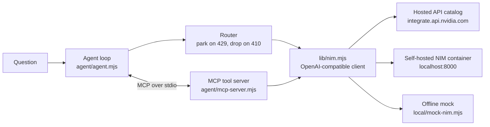
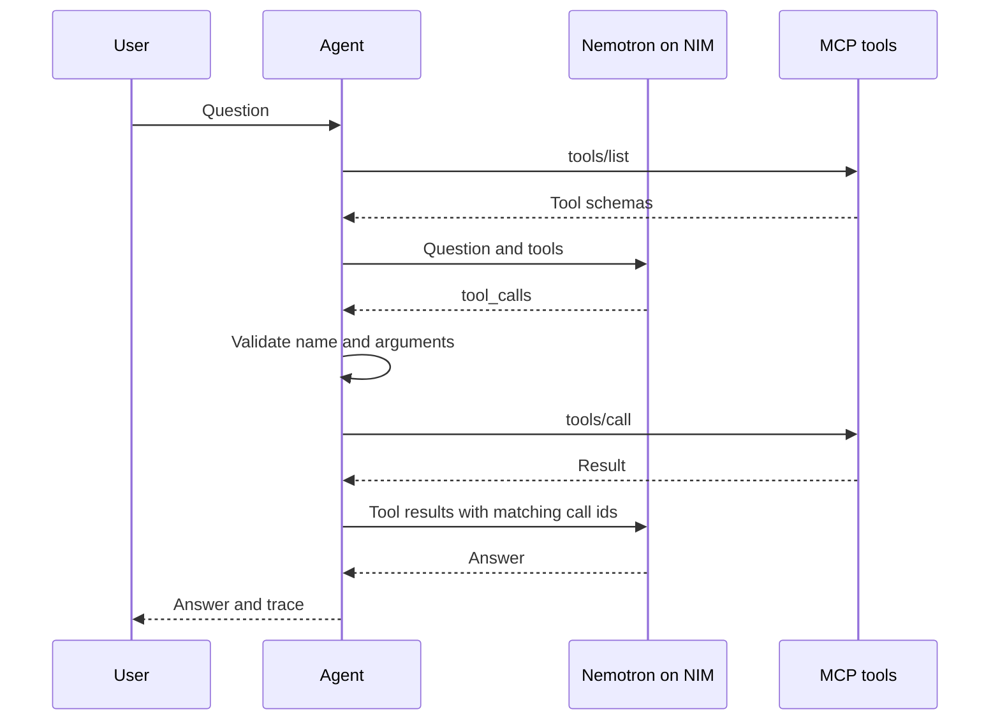
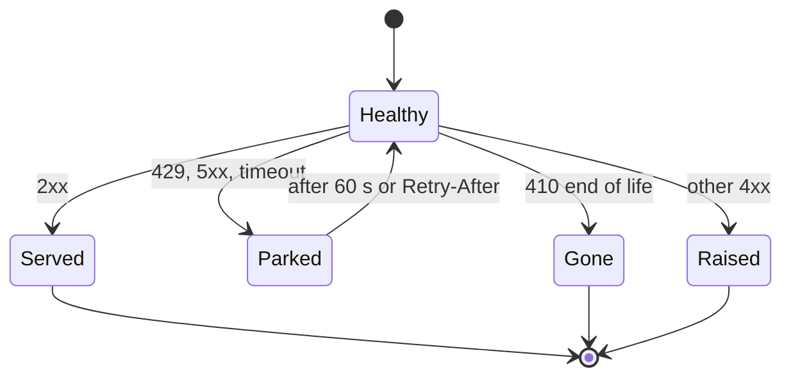

<!--
SPDX-FileCopyrightText: Copyright (c) 2026 Jeremy Schoemaker
SPDX-License-Identifier: Apache-2.0
-->

# MCP Tool-Calling Agent with Model Failover on NVIDIA NIM

This self-contained example shows an agent that runs on an NVIDIA Nemotron model through the OpenAI-compatible NIM API and calls tools over the Model Context Protocol (MCP). A small router sits under the agent, so a rate limited or retired model does not end the conversation. The same code runs against the hosted API catalog, a self-hosted NIM container, or any OpenAI-compatible server by changing one environment variable.

The example is educational. It is not a production gateway, it does no load balancing across keys or regions, and the timings it prints are a snapshot of one client against one endpoint, not a benchmark of any hardware.



One client talks to all three backends. `NIM_BASE_URL` picks which one.

## What it demonstrates

- Discover chat models from `GET /v1/models` at run time. Model ids are never hard coded as truth.
- Connect an agent to MCP tools: list tools over stdio, convert their schemas to OpenAI `tools`, run the tool calls the model asks for, and return results with matching call ids.
- Enforce a tool floor in code: unknown tools, invalid arguments, tool errors, oversized results, repeated calls and a step limit are all handled without trusting the model.
- Fail over between models by error class. HTTP 429, 5xx and timeouts park a model for a while. HTTP 410 (end of life) drops it for the session. Other 4xx errors are raised, because another model will not fix a bad request or a bad key.
- Measure time to first token and tokens per second for the models you are about to route between.
- Run everything offline against a bundled mock of the API, with fault injection, so the failure paths can be shown and tested without a key.

## Prerequisites

- Node.js 20 or newer.
- No GPU and no credential for the offline mode and the tests.
- An NVIDIA API key from [build.nvidia.com](https://build.nvidia.com) for the hosted mode.

## Quick start

Run from this directory:

```bash
cd community/nim-mcp-agent-failover
npm install
npm test                          # 80 tests, no network, no key
bash scripts/demo.sh --offline    # five acts against the bundled mock
```

With a key, the same five acts run against the hosted API catalog:

```bash
export NVIDIA_API_KEY=nvapi-...
bash scripts/demo.sh
```

The five acts are: a first streamed call, a short latency measurement, a failover across a rate limited model and a retired model, a routed request to the fastest healthy model, and the agent answering a question with MCP tool calls. Set `DEMO_PAUSE=1` to step through them.

## The agent

```bash
node agent/agent.mjs "Is meta/llama-3.1-8b-instruct still available? If not, which small Nemotron model should I use for a tool-calling agent? Check that your pick is alive and supports tools."
```

A real run against the hosted API catalog on 2026-11-21, trimmed. The model that served each step is on the step line:

```text
Step 1: nvidia/nemotron-3.5-bolt-e4b
  check_model({"model":"meta/llama-3.1-8b-instruct"}) 177 ms
     {"status":"end_of_life","httpStatus":410,"detail":"The model 'meta/llama-3.1-8b-instruct' has reached its end of life on 2026-08-26T09:00:00Z and is no longer available."}
Step 2: nvidia/nemotron-3.5-bolt-e4b
  list_models({"filter":"nemotron"}) 46 ms
Step 3: nvidia/nemotron-3.5-bolt-e4b
  check_model({"model":"nvidia/nemotron-3.5-bolt-e4b"}) 203 ms
     {"status":"alive","httpStatus":200}
Step 4: nvidia/nemotron-3.5-bolt-e4b
  supports_tools({"model":"nvidia/nemotron-3.5-bolt-e4b"}) 238 ms
     {"supportsTools":true}
Step 5: nvidia/nemotron-3.5-bolt-e4b

The model `meta/llama-3.1-8b-instruct` is end-of-life as of 2026-08-26T09:00:00Z.
For a small NVIDIA Nemotron model suitable for a tool-calling agent, I recommend `nvidia/nemotron-3.5-bolt-e4b`.
```

The answer comes from the tool results. The end-of-life date is the text the API returned with the 410, not something the model remembered.



### The tool floor

These rules are enforced by the loop, in code, whatever the model does:

| Condition | What happens |
| --- | --- |
| Unknown tool name | The model gets a tool result saying so, and can correct itself |
| Arguments are not valid JSON, or a required field is missing | The tool is not run. The model gets the validation error |
| The tool throws | The error text becomes the tool result |
| Result over about 6000 characters | Truncated, with a marker |
| The same call with the same arguments three times in a row | The run stops with a clear message, exit code 2 |
| The step limit is reached (`--max-steps`, default 8) | The run stops with a clear message, exit code 2 |

If a model turn fails with a 429, a 5xx or a 410 in the middle of a conversation, the router hands the same message history to the next model and the run continues.

The agent starts the bundled MCP server (`agent/mcp-server.mjs`), which exposes four tools:

| Tool | What it returns |
| --- | --- |
| `list_models` | Live catalog ids, with an optional substring filter |
| `check_model` | `alive`, `end_of_life` with the server's detail text, `rate_limited`, `not_chat` or `error` |
| `measure_model` | Median time to first token and tokens per second from one to three short streams |
| `supports_tools` | Whether the model returned a well formed tool call for a trivial tool |

Use your own MCP server instead of, or as well as, the bundled one:

```bash
node agent/agent.mjs "your question" --mcp "npx -y your-mcp-server"
```

Custom `--mcp` servers do not receive `NVIDIA_API_KEY` unless you pass `--mcp-share-key`. Add `--json` for the full trace: every step, tool call, model used and the route log.

By default the agent tries NVIDIA's small Nemotron models first, intersected with the live catalog: `nvidia/nemotron-3.5-bolt-e4b`, then `nvidia/nemotron-3.5-lightning-30b-a3b`, then `nvidia/nemotron-3-nano-omni-30b-a3b-reasoning`. Pin one with `--model` or `NIM_MODEL`.

## The router

```bash
node router/nim-route.mjs models --probe     # classify every catalog entry: chat, gone, rate-limited, not-chat, error
node router/nim-route.mjs bench --runs 5     # time to first token and tokens per second
node router/nim-route.mjs route --prompt "Say hi in five words."
```

| Response | What the router does |
| --- | --- |
| 429, 5xx, timeout, network error | Parks the model for 60 seconds, or for `Retry-After`, and tries the next one |
| 410 end of life | Drops the model for the rest of the session |
| Other 4xx | Raises the error. No failover |

A route log from the offline demo, where the first model is rate limited and the second is retired:

```json
[{"model":"mock/busy","error":429,"parked":true},{"model":"mock/retired","error":410,"gone":true},{"model":"mock/fast","served":true}]
```



### Measured on the hosted API catalog

Five sequential streamed runs per model, one model at a time, 256 max tokens, temperature 0.2, one client, 2026-11-21. Medians, with the range beside them. Rerun `bench` to get your own numbers: this is one snapshot of a shared endpoint.

| Model | Median time to first token | Range | Median tokens per second |
| --- | --- | --- | --- |
| nvidia/nemotron-3.5-bolt-e4b | 179 ms | 178 to 269 | 88.7 |
| nvidia/nemotron-3.5-lightning-30b-a3b | 121 ms | 119 to 140 | 185.2 |
| nvidia/nemotron-3-nano-omni-30b-a3b-reasoning | 138 ms | 114 to 1107 | 85.0 |
| nvidia/nemotron-3.5-super-vl-120b-a12b | 376 ms | 348 to 885 | 129.5 |
| nvidia/nemotron-3-ultra-550b-a55b | 472 ms | 455 to 2267 | 37.3 |

## Hosted to self-hosted

Every command reads `NIM_BASE_URL`. Point it at another OpenAI-compatible `/v1` endpoint and set `NIM_MODEL` to an id that server lists:

```bash
export NIM_BASE_URL=http://localhost:8000/v1
node router/nim-route.mjs models
NIM_MODEL=<id from the list> node agent/agent.mjs "List the models on this server, then check that the first one is alive and supports tools."
```

`local/docker-compose.yml` starts a self-hosted NIM container. Set `NIM_IMAGE` to an image from the NGC catalog and `NGC_API_KEY` in your environment, then `docker compose -f local/docker-compose.yml up -d`.

### Fitting a 24 GB GPU

The compose file was run once, on 2026-11-21, on a single rented NVIDIA L4 (24 GB) with `nvcr.io/nim/nvidia/nemotron-3.5-bolt-e4b-4gb:2.1.4`. Three things came up in that run. They are observations from one run on one card, not general statements about NIM:

| What happened | What fixed it |
| --- | --- |
| The image is about 51 GB on disk and a 120 GB volume filled before the model download. | Use 200 GB or more. |
| With default settings the engine stopped at startup: the video decoder cache asked for 2.05 GiB and 1.69 GiB was left for the KV cache. | Set `NIM_SPECDEC_ENABLE=0` and raise GPU memory utilization through `NIM_PASSTHROUGH_ARGS`. |
| Setting `NIM_PASSTHROUGH_ARGS` replaced the image's default tool calling flags, so requests with `tools` returned HTTP 400. | Add the flags back in the same variable. |

The settings used for that run:

```bash
export NIM_SPECDEC_ENABLE=0
export NIM_PASSTHROUGH_ARGS="--gpu-memory-utilization 0.97 --enable-auto-tool-choice --tool-call-parser gemma4 --reasoning-parser gemma4"
```

With those settings the agent completed three MCP tool calls against the self-hosted container, and five sequential streamed runs measured a median of 83 ms to first token and 26.4 tokens per second, with speculative decoding off and the client on the same host.

## What was run

| Path | Status |
| --- | --- |
| Hosted API catalog | Run on 2026-11-21 |
| Self-hosted NIM container on an NVIDIA L4 | Run once on 2026-11-21, on a rented instance |
| Offline mock | Run in the tests and the demo |
| Linux, and macOS with the stock bash 3.2 | Tests and both demo modes |

## Files

| Path | Purpose |
| --- | --- |
| `agent/agent.mjs` | Agent loop, MCP client wiring, tool floor |
| `agent/mcp-server.mjs` | MCP server with the four NIM tools |
| `router/nim-route.mjs` | `models`, `bench`, `route` and the `Router` class |
| `lib/nim.mjs` | Small client: config, errors, model listing, chat, streaming with timings. No dependencies |
| `local/mock-nim.mjs` | Offline OpenAI-compatible mock with fault injection |
| `local/docker-compose.yml` | Self-hosted NIM container recipe |
| `quickstart/node/quickstart.mjs` | A first streamed call in one file |
| `scripts/demo.sh` | The five-act demo |

The only dependencies are `@modelcontextprotocol/sdk` and `zod`, used by the agent.

## Troubleshooting

| You see | Cause | Fix |
| --- | --- | --- |
| A message that the key is missing or wrong (HTTP 401 or 403) | `NVIDIA_API_KEY` is not exported in this shell, or is not valid | Export a key from build.nvidia.com |
| HTTP 410 for a model id from an older tutorial | The model reached end of life | Run `node router/nim-route.mjs models` and pick a current id |
| HTTP 404 from a catalog entry | The entry is not a chat model (embedding, safety, vision) | Run `models --probe` to see which entries answer chat |
| Empty answer from a reasoning model | The token budget went to `reasoning_content` | Raise `--max-tokens` on `route` or `bench` |
| HTTP 400 about tool choice on a self-hosted container | The tool calling flags are not set | See "Fitting a 24 GB GPU" |
| "Port 8089 is busy" from the demo | Another process holds the mock's port | `MOCK_PORT=8189 bash scripts/demo.sh` |

## Notes

- Keys are read only from the `NVIDIA_API_KEY` environment variable and are redacted from tool results and error output.
- Reasoning models return their thinking in `reasoning_content`. The time to first token counts the first content or reasoning delta.
- A longer write-up, with raw measurement files, is at [github.com/shoemoney/nim-devrel-kit](https://github.com/shoemoney/nim-devrel-kit).
